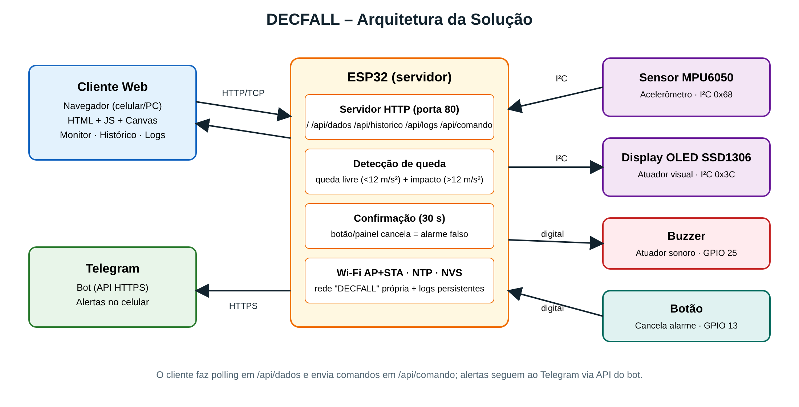
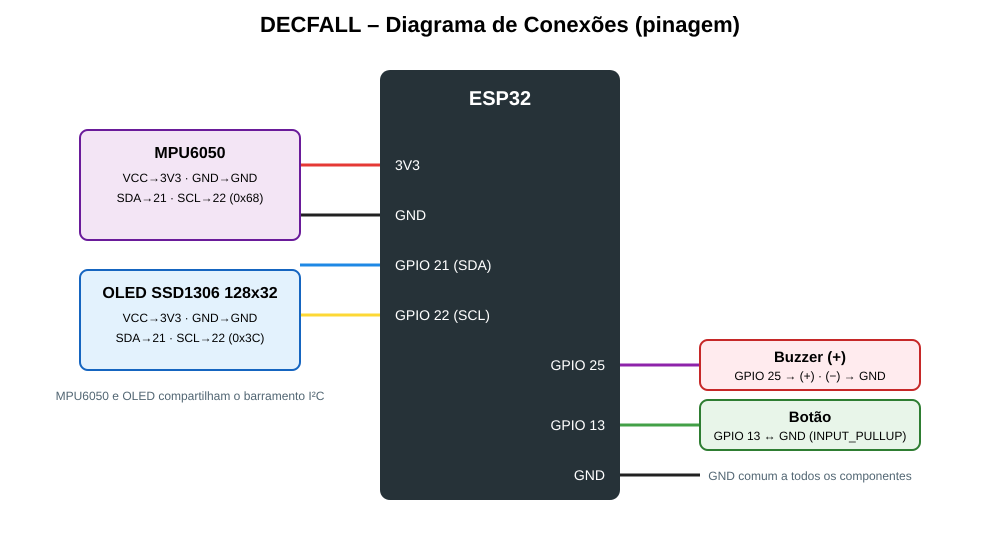

# DECFALL – Detector de Quedas Ciberfísico

Sistema ciberfísico baseado em **ESP32** que detecta possíveis quedas de uma pessoa (ex.: idosos) usando um acelerômetro, dispara alarme sonoro/visual e avisa um responsável pelo **Telegram**. Um painel web servido pelo próprio ESP32 permite acompanhar a aceleração em tempo real, ver o histórico de quedas e os logs.

**Problema resolvido:** quedas sem socorro rápido agravam lesões. O DECFALL detecta o padrão de queda (queda livre seguido de impacto), dá 30 s para cancelar alarmes falsos (botão ou painel) e, se ninguém cancelar, marca a queda como **confirmada** e notifica o responsável.

## Integrantes da Equipe

| Nome completo |
|---|
| Lucas Teixiera Coelho |
| Carlos Eduardo Godoy Esmanhotto | 
| Lucas Pereira Maciel | 
|Luiz Gustavo de Souza Murbach |
| Victor Schotten Rosa |

## Arquitetura da Solução



- **Cliente:** navegador (celular/PC) acessa o painel HTML/JS servido pelo ESP32.
- **Servidor:** ESP32 com servidor HTTP (TCP, porta 80), em modo AP+STA (cria a rede `DECFALL` e também conecta ao Wi-Fi local).
- **Sensor:** MPU6050 (acelerômetro, I²C).
- **Atuadores:** buzzer, display OLED SSD1306 e mensagens no Telegram.
- **Entrada:** botão físico para cancelar alarme falso.

Lógica de detecção: aceleração total < 12 m/s² por ≥ 60 ms (queda livre) seguida de pico > 12 m/s² em até 1 s (impacto) → alerta **pendente** por 30 s → se ninguém cancelar, **queda confirmada**.

## Hardware Utilizado

| Componente | Função |
|---|---|
| ESP32 DevKit | Microcontrolador / servidor HTTP |
| MPU6050 | Acelerômetro (sensor) |
| Display OLED SSD1306 128x32 | Atuador visual |
| Buzzer ativo | Atuador sonoro |
| Botão (push button) | Cancelar alarme |
| Protoboard e jumpers | Montagem |

### Pinagem



| Componente | Pino do componente | Pino do ESP32 |
|---|---|---|
| MPU6050 / OLED | VCC / GND | 3V3 / GND |
| MPU6050 / OLED | SDA | GPIO 21 |
| MPU6050 / OLED | SCL | GPIO 22 |
| Buzzer | (+) | GPIO 25 |
| Botão | um terminal / outro | GPIO 13 / GND (usa `INPUT_PULLUP`) |

## Documentação da API / Comunicação

Todas as rotas usam **HTTP GET** na porta 80 (IP da rede local ou `192.168.4.1` na rede `DECFALL`).

| Endpoint | Descrição | Resposta |
|---|---|---|
| `/` | Painel web (HTML) | `text/html` |
| `/api/dados?desde=N` | Leitura atual: aceleração, eixos x/y/z, estado do alerta, rede e novas amostras desde a sequência `N` | JSON |
| `/api/historico` | Últimas 20 quedas (hora, pico, status, origem do cancelamento) | JSON |
| `/api/logs` | Logs do sistema (persistidos na memória flash) | `text/plain` |
| `/api/comando?acao=cancelar` | Cancela o alarme (marca como alarme falso) | `{"ok":true}` |
| `/api/comando?acao=teste_buzzer` | Aciona o buzzer por 1 s | `{"ok":true}` |
| `/api/comando?acao=simular` | Simula uma queda (teste) | `{"ok":true}` |

Exemplo:
```bash
curl http://192.168.4.1/api/dados
curl "http://192.168.4.1/api/comando?acao=simular"
```

**Telegram:** o ESP32 envia mensagens via API HTTPS do bot (biblioteca UniversalTelegramBot) em: inicialização, possível queda, queda confirmada e alarme cancelado.

## Instruções de Instalação e Execução

### 1. Pré-requisitos
- Arduino IDE 2.x com suporte a ESP32 (Boards Manager → *esp32 by Espressif*).
- Bibliotecas (Library Manager): `Adafruit GFX Library`, `Adafruit SSD1306`, `UniversalTelegramBot`, `ArduinoJson`.
- Um bot do Telegram: crie com o **@BotFather** (obtém o token) e descubra seu ID com o **@myidbot**.

### 2. Configurar credenciais
```bash
cd src/esp32/Detector
cp secrets.h.example secrets.h
```
Edite `secrets.h` com Wi-Fi, token e chat ID. **Esse arquivo não é versionado** (`.gitignore`).

### 3. Gravar o ESP32
1. Abra `src/esp32/Detector/Detector.ino` na Arduino IDE.
2. Placa: *ESP32 Dev Module*. Selecione a porta e clique em **Upload**.
3. Abra o Serial Monitor (115200) para ver o IP.

### 4. Usar o cliente
- Conecte-se à mesma rede Wi-Fi e abra `http://<IP do ESP32>`, ou conecte-se à rede `DECFALL` e abra `http://192.168.4.1`.
- `src/client/index.html` é uma cópia legível do painel; a versão embarcada está em `src/esp32/Detector/pagina.h`.


